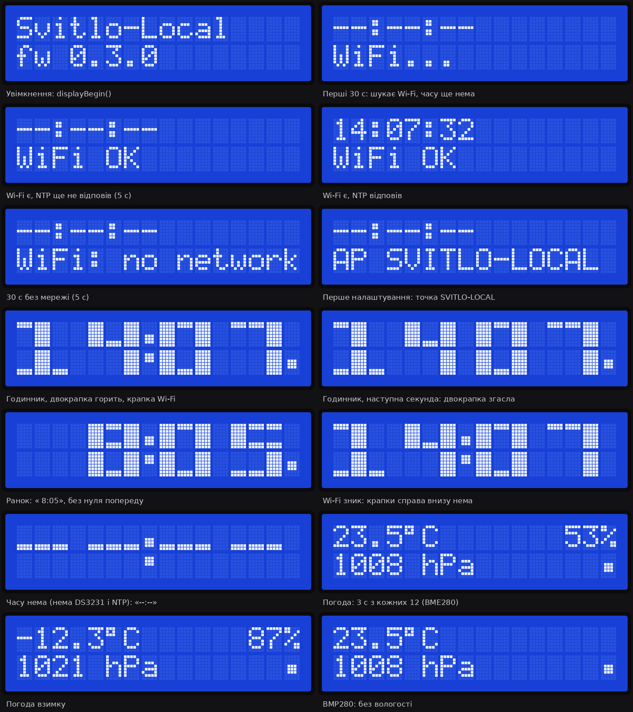
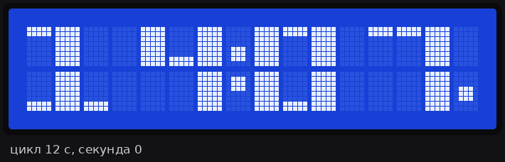
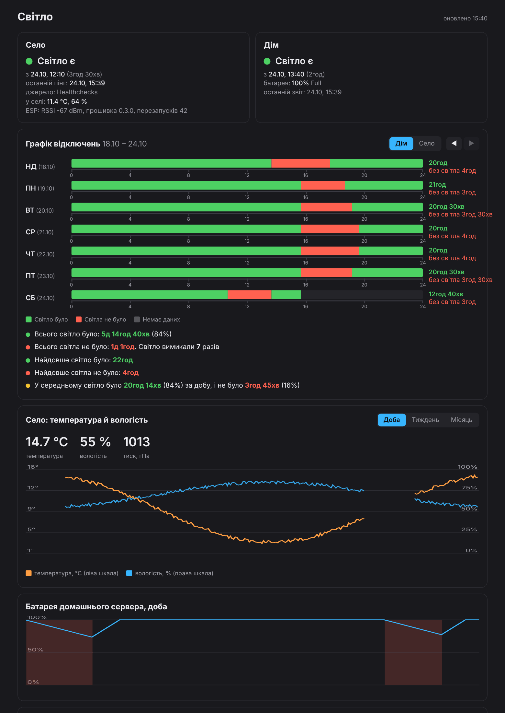

# Svitlo-Local

Власний моніторинг світла без хмари СвітлоБот: **село** (ESP8266 у розетці) і **дім** (ноутбук-сервер Proxmox).
Clean room: зроблено лише за власною специфікацією, без коду SvitloBoard.

## Як це працює

```
 СЕЛО                              ІНТЕРНЕТ                         VPS (Німеччина)
 ESP8266 ──HTTPS пінг раз/хв──▶ hc-ping.com (Healthchecks) ◀──опитує API раз/хв── svitlo-poller ─┐
 (та сама розетка, що й роутер)                                                                   ├─ SQLite
                                                                                   svitlo-web ◀───┘
 ДІМ                                                                               10.0.0.1:3003
 ноутбук pve: power-guard ──POST /api/power раз/30 с── WireGuard (лише 10.0.0.1) ──▶ (тільки через WG)
```

- **Ніде не відкрито жодного нового порту.** ESP і ноутбук тільки ходять назовні. Дашборд слухає лише WireGuard-адресу VPS.
- **Село.** Світло є, поки ESP живий і пінгує. Пінгів нема довше 3 хв: «немає сигналу, ймовірно, нема світла».
- **Дім.** power-guard на хості Proxmox читає зарядку (`ADP1/online`) і батарею (`BAT1`).

## Склад репозиторію

| Тека | Що це |
|---|---|
| `server/` | Веб і опитувач (Python, FastAPI, SQLite) у Docker Compose на VPS |
| `power-guard/` | Сервіс для Proxmox-хоста: стежить за зарядкою, засинає, вимикається при розряді |
| `firmware/` | Прошивка NodeMCU (ESP8266): пінг, точка налаштування, LCD, BME280, DS3231 |
| `tools/emulator.py` | Емулятор ESP і power-guard для тестів без заліза |
| `tools/lcd_preview.py` | Картинки екранів LCD 1602 з логіки `display.cpp` (потрібен Pillow) |
| `docs/` | Картинки: екрани LCD і дашборду в різних станах |
| `tests/` | Юніт-тести машин станів і API |

## Як це виглядає

### LCD 1602 на платі

Усі екрани, які показує прошивка (`docs/lcd/`). Картинки генерує `python tools/lcd_preview.py`: це порт `compose()` з `display.cpp` з тими самими CGRAM-символами, тож після змін у дисплеї їх варто перегенерувати.



Цикл 12 с: 9 с великий годинник (двокрапка блимає раз на секунду), 3 с погода.



### Дашборд

Знімки на синтетичних даних (`docs/dashboard/`).

| Стан | Знімок |
|---|---|
| Все гаразд, графік «Дім» | [01-normal-home.png](docs/dashboard/01-normal-home.png) |
| Перемикач графіка на «Село» (жовте — світло було, не було зв'язку) | [02-switch-village.png](docs/dashboard/02-switch-village.png) |
| Температура за тиждень + технічні події в журналі | [03-env-week-tech-log.png](docs/dashboard/03-env-week-tech-log.png) |
| Попередній тиждень (◀) | [04-prev-week.png](docs/dashboard/04-prev-week.png) |
| Село: немає сигналу | [05-village-offline.png](docs/dashboard/05-village-offline.png) |
| Дім: працює від батареї | [06-home-on-battery.png](docs/dashboard/06-home-on-battery.png) |
| Дім: сервер спить | [07-home-sleeping.png](docs/dashboard/07-home-sleeping.png) |
| Дім вимкнувся через розряд + збирач не працює | [08-home-off-poller-dead.png](docs/dashboard/08-home-off-poller-dead.png) |
| Телефон (390 px) | [10-mobile.png](docs/dashboard/10-mobile.png) |



## Встановлення

### 1. Сервер на VPS
1. Скопіювати `server/` на VPS у `~/svitlo-local` (`scp` або tar через ssh).
2. `cp .env.example .env && chmod 600 .env` і заповнити поля (пояснення є в самому файлі).
3. `docker compose up -d --build`

**Готово, коли** `curl http://10.0.0.1:3003/api/status` з ПК через WireGuard повертає JSON.

Бекап: `svitlo-backup.sh` щоночі о 04:30 (cron) кладе перевірений знімок у `~/backups/svitlo-local`, зберігаються 14 останніх.

### 2. WireGuard pve → VPS
- На pve: `apt install wireguard-tools`, ключ у `/etc/wireguard/wg-svitlo.key`, конфіг `/etc/wireguard/wg-svitlo.conf`, `AllowedIPs = 10.0.0.1/32`. Через тунель іде лише VPS, решта трафіку йде як завжди.
- На VPS: `sudo ./wg-add-pve-peer.sh <публічний ключ pve>` додає пір (pve отримав 10.0.0.6).
- `systemctl enable --now wg-quick@wg-svitlo`

**Готово, коли** `ping 10.0.0.1` з pve відповідає.

### 3. power-guard на Proxmox-хості
1. Скопіювати `power-guard/` на хост, виконати `./install.sh` від root.
2. У `/etc/power-guard.conf` вписати `TOKEN`: сам токен. На VPS у `.env` лежить лише його sha256 (`POWER_KEY_SHA256`).
3. `journalctl -u power-guard -f`: має бути `event guard_start`.

**Готово, коли** у дашборді «Дім» показує «Світло є» і відсоток батареї.

Кришка ноутбука: потрібно `HandleLidSwitch=ignore`. На pve це вже стоїть у `/etc/systemd/logind.conf`, тому `install.sh` нічого не міняє. Якщо там цього нема, він кладе окремий файл `/etc/systemd/logind.conf.d/svitlo-lid.conf`. Видалите файл, і все повернеться як було.

## Прошивка ESP8266 (NodeMCU)

Збірка і прошивка через PlatformIO (`pip install platformio`), з теки `firmware/`:
```
python -m platformio run -t upload --upload-port COM16     # по USB
python -m platformio run -e ota -t upload                  # по Wi-Fi, кабель не потрібен
```
Для прошивки по Wi-Fi скопіюйте `secrets.ini.example` у `secrets.ini` (він не потрапляє в git) і впишіть адресу плати та пароль адміністратора. Символ `%` у паролі пишеться як `%%`. Прошивка йде через сторінку плати `/update`; туди ж можна завантажити `.bin` вручну з браузера.
Перший запуск: плата піднімає Wi-Fi **SVITLO-LOCAL** (без пароля), сторінка налаштувань `http://192.168.4.1/settings`.
Туди вписуються до 3 мереж Wi-Fi, URL `https://hc-ping.com/<UUID>`, пароль адміністратора (≥8 символів).
Далі сторінка статусу — `http://svitlo-local.local/` або IP з роутера; налаштування — `/settings` (логін `admin`), оновлення прошивки — `/update`.

- Немає жодної відомої мережі 1 хв → знову вмикається SVITLO-LOCAL (з паролем адміністратора), плата далі шукає мережі.
- Плата підключається до **найсильнішої з відомих** мереж, які бачить (а не строго «основна → резервні»).
- **4 швидкі вмикання** (кожне коротше 5 с) → скидання до заводських.
- Пінг раз на 60 с, тіло: `uptime_s`, `boot_count`, `rssi`, `fw`, а також `t`, `h`, `p` з датчика. Після невдачі — повтор через 15 с.
- Плата **не перезавантажується** через відсутність інтернету: інакше зламалось би розрізнення «світло було, не було зв'язку» за `uptime_s`.
- HTTPS: за замовчуванням перевірка кореневого сертифіката Sectigo E46 (до 2038 р.), також «відбиток SHA-1» або «без перевірки».

Світлодіод: швидко блимає — нема Wi-Fi; подвійне блимання — лише точка налаштування; раз на секунду — Wi-Fi є, пінг не пройшов; короткий спалах раз на 5 с — все добре.

### Модулі (необов'язкові, без них плата працює)

| Модуль | Піни NodeMCU | Живлення |
|---|---|---|
| BME280 (температура, вологість, тиск) | SDA=D2, SCL=D1 | 3V3 |
| DS3231 (годинник з батарейкою) — **у зібраному корпусі не встановлено**, не помістився | SDA=D2, SCL=D1 (та сама шина) | 3V3 |
| LCD 1602 з I²C-модулем PCF8574 | SDA=D6, SCL=D5 (окрема шина) | VIN (5 V) |

- LCD на окремих пінах, бо I²C-модуль може підтягувати лінії до 5 V, а BME280 — 3,3-вольтовий.
- DS3231 тримає UTC; при старті плата бере час з нього, NTP раз на годину його підводить. CR2032 у ZS-042 безпечна лише при живленні 3V3.
- **Зараз DS3231 у корпусі немає** (фізично не вліз). Тому після кожного ввімкнення годинник показує `--:--`, доки не з'явиться інтернет і не відповість NTP (зазвичай кілька секунд після підключення до Wi-Fi). Пінги від цього не залежать: дати сертифіката до відповіді NTP перевіряються відносно дати прошивки. Якщо DS3231 колись додати, прошивка підхопить його без змін.
- Температура на сервері записується раз на 5 хв (графік «Село: температура й вологість» на дашборді).
- BME280 тримайте на дротах подалі від плати — ESP гріє його на 1–3 °C.
- LCD: великий годинник ГГ:ХХ на обидва рядки; кожні 12 с на 3 с — температура, вологість і тиск. Крапка справа внизу — Wi-Fi є (порожньо — нема); словами стан Wi-Fi показується лише 5 с після ввімкнення.
- Поправка температури: у налаштуваннях плати, за замовчуванням −1,4 °C (цей BME280 завищував на 1,3–1,5 °C). Вологість датчик перераховує з урахуванням поправки.
- Нічого не видно на LCD при увімкненій підсвітці — покрутіть синій потенціометр контрасту.

## Поведінка ноутбука без світла (power-guard)

| Стан | Що відбувається |
|---|---|
| NORMAL | Зарядка є, звіт раз на 30 с |
| ON_BATTERY | Зарядка зникла: одразу подія «світло вдома зникло», ноутбук працює як UPS |
| Сон | Через 10 хв без зарядки (або при заряді ≤30%): `rtcwake -m mem -s 300`, прокидається кожні 5 хв, перевіряє і знову спить |
| Розряд | При ≤7%: штатний `systemctl poweroff` із записом у журнал |

- **Чому `rtcwake`, а не `systemctl suspend`.** На pve `systemctl suspend` дає «Access denied», і ми це не обходимо. Підключення зарядки ноутбук не будить, Wake-on-LAN нема, тому працює лише таймер.
- **Точність.** Якщо світло повернулось під час сну, power-guard дізнається про це тільки при пробудженні. Тому час появи світла вдома має точність до 5 хв (у журналі «точність ±5 хв»).
- **Після повного розряду** ноутбук вмикається лише кнопкою: BIOS не вміє вмикатися сам. Дашборд на VPS показує банер «потрібен ручний запуск».
- **Журнал** лежить у `/var/lib/power-guard/journal.jsonl` (тільки дописується) і переживає перезавантаження. Неотримані сервером події чекають у `outbox.json` і надсилаються пізніше.
- `KEEP_AWAKE=true` вимикає сон взагалі.
- **Швидкість розряду у сні.** Кожна подія «сервер прокинувся» містить `drain_pct_per_h`. За нею підбирається `WAKE_INTERVAL`.
- **AdGuard і NAS засинають разом з ноутбуком.** Тому в роутері як запасний DNS стоїть 1.1.1.1, інакше під час сну в квартирі «зникне інтернет».

## Чесні прогалини (що система НЕ може розрізнити)

Пінгів із села нема, а сервер працює. Причини можуть бути такі: (а) у селі нема світла; (б) світло є, але впав інтернет чи роутер; (в) завис ESP.
Тому дашборд пише «Немає сигналу — ймовірно, нема світла», а не «точно нема світла».

Що допомагає розрізнити:
- ESP передає в тілі пінгу свій `uptime_s`. Якщо після перерви ESP **не перезапускався** (uptime більший за перерву), то світло було весь час, а не було лише зв'язку. Така подія позначається «зв'язок відновився (світло було)».
- Справжній момент появи світла дорівнює часу першого пінгу мінус `uptime_s`. Роутер вмикається 1–2 хв, і ця затримка так компенсується.
- Якщо дані могли загубитися, проміжок позначається **«невідомо»**, а не «відключення». Таке буває, коли VPS лежав довше 100 хв і Healthchecks уже витіснив старі пінги. Перевіряється це за безперервністю номерів пінгів `n`.

## Ризики Healthchecks
- Сервіс бачить час відключень і IP сільського роутера.
- **UUID перевірки — це секрет.** Хто його знає, може слати фальшиві пінги. Не публікуйте його.
- **API-ключ повний, не read-only.** Тіла пінгів (`uptime_s`) read-only ключ не віддає. Ключ лежить в окремому проєкті Healthchecks лише з цією перевіркою, тож у гіршому разі з ним можна зіпсувати тільки її.
- Безкоштовний план зберігає 100 останніх пінгів, тому повна історія зберігається лише в нашій базі.

## Тести

```
cd tests
python -m unittest
```

Без FastAPI тест API пропускається, решта працює на чистому Python.

## Діагностика

| Симптом | Де дивитись |
|---|---|
| «Дім: немає даних» | `ssh root@192.168.10.50 journalctl -u power-guard -n 50`, `wg show wg-svitlo` (є handshake?) |
| «Фоновий збирач не працює» | на VPS: `cd ~/svitlo-local && docker compose logs --tail 50 poller` |
| «Healthchecks недоступний» | текст помилки видно в картці «Село»; 401/403 означає неправильний ключ |
| Бекап | `~/svitlo-local/backup.log` |
